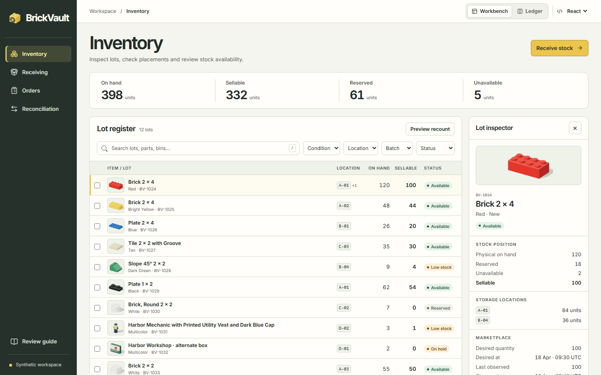
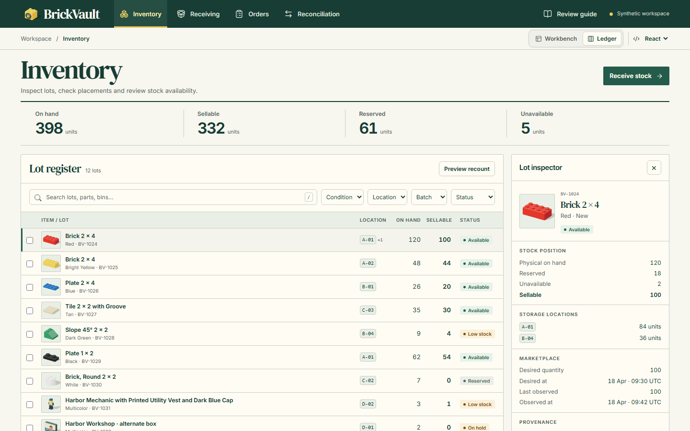

# M1 design and framework review

**Recommendation for the operator workspace:** Workbench navigation and Vue 3 with TypeScript. The darker side rail keeps the active task visible as the register scrolls. Workbench fits another complete lot on screen at each tested desktop width. Vue rendered the same register, passed the same tasks and shipped a smaller framework-specific bundle. The owner can select either layout with either framework. [M1 issue #4](https://github.com/abrianbaker80/BrickVault-V2/issues/4)

| Workbench | Ledger |
|---|---|
|  |  |
| Graphite rail, Inter headings, warm stock cards, yellow primary action. Suits repeated transitions among scanning, picking and stock lookup. | Green masthead, serif titles, ruled sections and a wider register. Suits reading a long lot or comparing placement details. |

## Open the review

Open the **brickvault-offline-preview** artifact from the M1 pull request’s passing workflow run, extract it and open `portable.html`. The file contains both frameworks, all illustrations, typefaces and four fictional scenarios. Open **Review guide** in the app for the test routes and a reset. The framework selector applies to Inventory. Switching layouts preserves the current task.

To build the same preview from the candidate branch, use Node 24.14 or later and run these commands from `prototypes/m1`.

```sh
npm ci
npx playwright install chromium
npm run build
npm test
npm run preview -- --port 49310 --strictPort
```

The preview listens on loopback. With it running, `node tools/observe.mjs` captures screenshots and timing samples in `evidence/`. On a fresh Linux runner, use `npx playwright install --with-deps chromium`. The normal web build loads the selected register on demand. The offline file bundles both so the reviewer can change frameworks without a server.

## Try the same four tasks

| Workspace | Try this | What to look for |
|---|---|---|
| Inventory | Press **/**, find BV-1024 and inspect bins A-01 and B-04. Check BV-1024 and BV-1025, filter down to BV-1026 and preview a recount. Change its scope and simulate a revision change. | Inspection leaves the action selection intact. Preview lists frozen IDs and revisions for selected lots, matching lots or the whole register. A changed lot is skipped and the receipt names it. The compact inspector restores focus to its row on Escape. |
| Receiving | Receive part PL-3020 in two counts, 5 and 7. Try the wrong bin before confirming B-12. | Intake and sellable quantities advance at separate steps. Reverse the last putaway to move those units back to intake. Activity retains both the original movement and its reversal. Price and publication shows how many verified units are eligible. |
| Orders | Pick BAG-41A for order BV-401, repeat its scan, report a short count, then recover BAG-41B. Pack and queue the label. Confirm the printed label, then hand off parcel P-401. Process the returned units. | A duplicate adds zero. The short line blocks pack and a pending print blocks handoff. Handoff releases the reservation and reduces physical stock together. Return inspection gates sellable stock. A pre-pack amendment adds a third bag. Reload the same tab mid-pick to resume its last confirmed step. |
| Reconciliation | Simulate a failed observation for batch SY-09, then a success. Review the mismatch and cancel once. Publish the correction to RC-03 and read back. | A lost response retains uncertainty. A successful read verifies a legitimate zero on RC-01. Publication changes one explicit lot. Its acknowledgement leaves verification pending until fresh observation. |

Inventory includes a long minifigure variant, alternate set box, split placements, multiple source batches, reserved stock, held stock and a known zero. Under **Read simulation**, compare Loading, Empty, Partial, Stale and Failed. Type a single letter followed immediately by an exact lot ID to exercise a superseded response. The four workspaces have independent fictional records. An operation in the receiving example does not populate the separate framework benchmark.

## Framework comparison

Each implementation covers the same 12-lot register. Both use the same typed fixtures and transition rules, CSS, bundled images, fonts, Vite build, keyboard tasks and viewport. React uses a TSX register and a typed detail component. Vue uses a single-file register and detail component. The shared receiving, order and reconciliation examples are outside the framework comparison. [React TypeScript](https://react.dev/learn/typescript) · [Vue TypeScript](https://vuejs.org/guide/typescript/overview.html)

Scores below are coordinator judgments on a five-point scale for this bounded task. Five indicates that the candidate met the tested requirement. Four identifies a measured tradeoff or a dimension with limited evidence. No operator task time was collected.

| D04 dimension | React | Vue | Evidence or tradeoff |
|---|---:|---:|---|
| Usability | 5 | 5 | Same search, explicit selection, inspector and recovery behavior. The keyboard-only route completed on both. |
| Visual quality | 5 | 5 | A same-host screenshot comparison of each register checks matching dimensions and at least 99.9% pixel agreement within its channel tolerance. The initial accessibility trees match exactly. |
| Maintainability | 4 | 4 | Both share domain rules. React subscribes with useSyncExternalStore. Vue bridges the store with a shallow ref and explicit cleanup. Both coordinate focus with DOM updates. The prototype provides little evidence about maintenance at application scale. |
| Performance | 4 | 5 | Vue sends fewer framework-specific JavaScript bytes. Local response times for either are practical for this fixture. See measured results below. |
| Accessibility | 5 | 5 | Shared tests cover field and row names, keyboard-only flow, modal cancellation, return focus, explicit text states and axe WCAG A/AA scans. Both handled the reduced viewport at real browser zoom. |
| Development efficiency | 4 | 4 | React inferred event targets directly. Vue used a typed event-value helper and a separate template. Both needed explicit focus lifecycle work. The same builder implemented React first and Vue second. That order prevents a credible hours-saved comparison. |

The architecture register’s earlier weighted assessment favored React by 0.10 on tooling assumptions. Both candidates supported this register’s actual test and build workflow. The smaller measured Vue bundle is the tie-breaker for the browser client. Browser startup, device access and maintenance costs at production inventory volume remain future qualification.

## Measurements and visual checks

| Framework entry | JS gzip size | First register paint, median (range) | Search result paint, median (range) |
|---|---:|---:|---:|
| react | 68.9 KiB | 83 ms (78–90) | 97 ms (88–104) |
| vue | 28 KiB | 72 ms (69–79) | 102 ms (95–113) |

At 1440 × 900, Workbench showed 9 complete inventory rows and Ledger showed 8. At 1280 × 720 the counts were 6 and 5. At 900 × 760 they were 7 and 6. The starting order and lot details were identical.

Local verification passed 27 browser tests, TypeScript checking, production and standalone builds. The suite includes both directions, both frameworks, independent scope and custody assertions, a keyboard-only route and an offline open with network disabled. GitHub Actions runs the same acceptance suite and uploads the standalone file.

The local run used the production build, Chromium on Windows, one workstation and loopback. Nine fresh browser contexts per framework alternated engine order. First register paint measures navigation start to the second animation frame after the first lot button appears. Exact-ID search measures input to the second frame after the expected result, including an intentional 80 ms read delay. Bundle sizes are gzip-compressed bytes for the framework-specific entry, excluding shared shell, model, images and styles. Compare repeated measurements within this run. [Raw samples and geometry](evidence/measurements.json) · [Observation script](tools/observe.mjs)

| View | Workbench | Ledger |
|---|---|---|
| 1280 × 720 | [Register](evidence/workbench-1280.png) · [Receiving](evidence/workbench-receiving.png) | [Register](evidence/ledger-1280.png) · [Receiving](evidence/ledger-receiving.png) |
| 900 × 760 | [Register](evidence/workbench-900.png) · [Inspector](evidence/workbench-inspector-900.png) | [Register](evidence/ledger-900.png) · [Inspector](evidence/ledger-inspector-900.png) |
| 150% native Chromium zoom | [Workbench](evidence/workbench-150pct.png) | [Ledger](evidence/ledger-150pct.png) |

At a register width below 920 CSS pixels, inspecting a lot opens a scrollable modal so every detail and action remains reachable. At 150% zoom the 1280 × 720 browser window provided an 839 × 415 CSS-pixel content area on the test host. Both engines and layouts opened the inspector, restored row focus and kept document width inside the viewport. Owner visual preference and a human assistive-technology session remain unmeasured. Axe checks and accessibility-tree assertions cover specific machine-testable behavior. [Playwright accessibility testing](https://playwright.dev/docs/accessibility-testing)

## Decision

The owner selects **Workbench or Ledger** for navigation and visual design and **Vue or React** for the frontend. The issue records the selection and milestone acceptance after owner review. The interactive sample establishes design evidence using fictional data. M2 has its own authorization gate.
